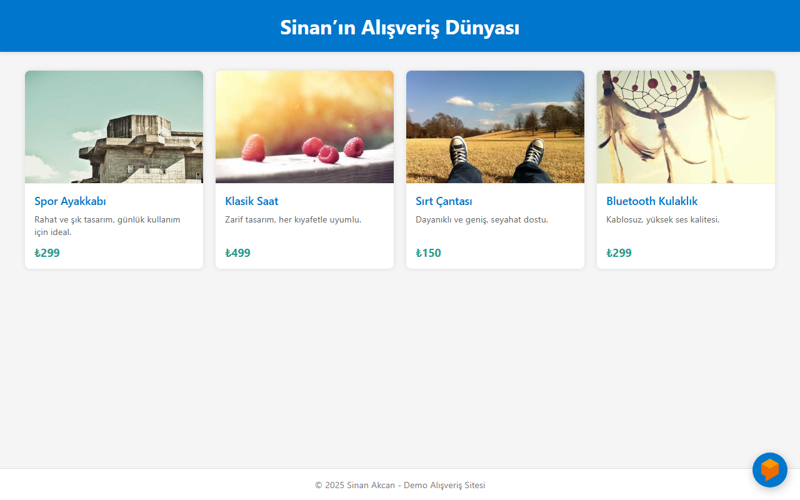

# DestekChatBot – Dialogflow Support Chatbot

A demo shopping page with an embedded **Google Dialogflow** customer-support chatbot ("DestekChatBot"), built for the *Cloud Computing* course at Manisa Celal Bayar University (2025).

The page is a single static `index.html` (HTML + CSS grid product cards). The chatbot is added with the **Dialogflow Messenger** web component, configured for Turkish (`language-code="tr"`) and styled to match the page colours. The conversation logic (intents, welcome message, answers) lived in the Dialogflow agent on Google Cloud.

> **Note:** The Dialogflow agent used in the course is no longer active, so the chat widget still opens but does not answer anymore. The screenshot shows the page as it was built.

## Tech

HTML · CSS · Google Cloud Dialogflow (Messenger integration)

## Running

Open `index.html` in a browser. No build step is needed.

---

**TR:** Bulut Bilişim dersi için hazırladığım, Google Dialogflow ile çalışan bir müşteri destek chatbot'u içeren demo alışveriş sayfası. Derste kullanılan Dialogflow ajanı artık aktif olmadığı için sohbet penceresi açılıyor ancak yanıt vermiyor.
